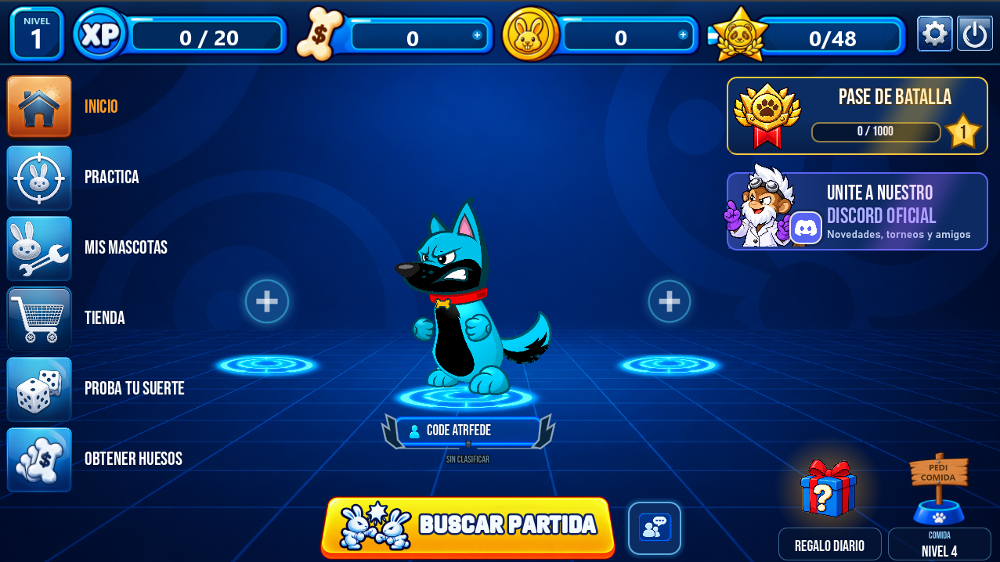

# Federico Viceconte

## Proyecto destacado · WO Definitive Edition

Juego 2D multijugador de artillería por turnos, creado en Godot entre tres amigos. Las partidas en línea reúnen hasta seis jugadores y combinan armas, escenarios destructibles y mascotas personalizables.

**Mi rol:** lo creamos los tres en conjunto y yo desarrollé muchas de sus funciones en todas las áreas: la jugabilidad por turnos, el sistema de armas, el multijugador en línea, los escenarios destructibles y las mascotas.

Junto al equipo también desarrollé el bot de la comunidad en Discord, [WO Guardian](https://github.com/federicoviceconte5-jpg/bot-discord), con bienvenida en cinco idiomas, tickets de soporte y novedades traducidas automáticamente.

[Visitar la web del juego](https://wodefinitiveedition.com/) · [Ver el repositorio público de la web](https://github.com/wo-definitive/wo-definitive.github.io)

## Proyectos propios

- [Gestión Canchas](https://github.com/federicoviceconte5-jpg/gestioncanchas) — Aplicación de escritorio en C# y Windows Forms para administrar canchas, horarios, reservas y pagos con SQL Server LocalDB.
- [Bot de Discord · WO Guardian](https://github.com/federicoviceconte5-jpg/bot-discord) — Bot en Node.js y discord.js con bienvenida multilingüe, tickets de soporte, sugerencias y anuncios traducidos.
- [Khalifa Barbershop](https://github.com/federicoviceconte5-jpg/khalifa-barbershop) — **Proyecto académico full stack.** Sitio de barbería con React, Express y MySQL, con catálogo, formulario de contacto y panel de administración de novedades.

## Proyectos compartidos

- [Mi espacio](https://github.com/RenzoLeporace/habit-tracker-v4) — App en Flutter para seguir hábitos y gestionar finanzas personales. [Demo](https://renzoleporace.github.io/habit-tracker-v4/)
- [FRR Soluciones IT](https://github.com/F-R-R-ENTERTAINMENT/f-r-r-entertainment.github.io) — Sitio de servicios de tecnología, infraestructura y soporte IT.
- [Sistema de Gestión Gruppe Sechs](https://github.com/RenzoLeporace/sistema-gestion-gruppe-sechs) — Aplicación de escritorio en C# y Windows Forms para gestionar servicios de seguridad, contratos y facturación.
- [Crono Runner](https://github.com/RenzoLeporace/crono-runner) — Juego educativo de plataformas para explorar épocas históricas a través de misiones y preguntas.
